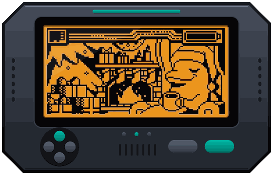

# Security Researcher

**Hardware Security · Reverse Engineering · Offensive Security**

 

  

---

## About

Security researcher focused on the intersection of hardware and software. I work on RF analysis, embedded firmware, and reverse engineering, with a practical approach to vulnerability research and secure design.

---

## Core Competencies

| Domain | Focus Areas |
|---|---|
| **Hardware Security** | RF / Sub-GHz analysis, ESP32 firmware development, Flipper Zero tooling and scripting |
| **Reverse Engineering** | Binary analysis, game engine internals, x86 / ARM assembly |
| **Software Development** | C / C++, Python, secure architecture design |
| **Offensive Security** | Vulnerability assessment, penetration testing, authorized red-team tooling |

---

## Tech Stack

---

## Featured Projects

- **[Project name]** – One-line description of what it does and the problem it solves.
- **[Project name]** – One-line description.
- **[Project name]** – One-line description.

---

## Certifications & Profiles

- TryHackMe – [your profile link]
- Add certifications here (e.g. eJPT, OSCP, CompTIA Security+)

---

## Contact

- Email: your@email.com
- LinkedIn: [your profile link]

---

All security research is conducted in authorized, legal environments.
